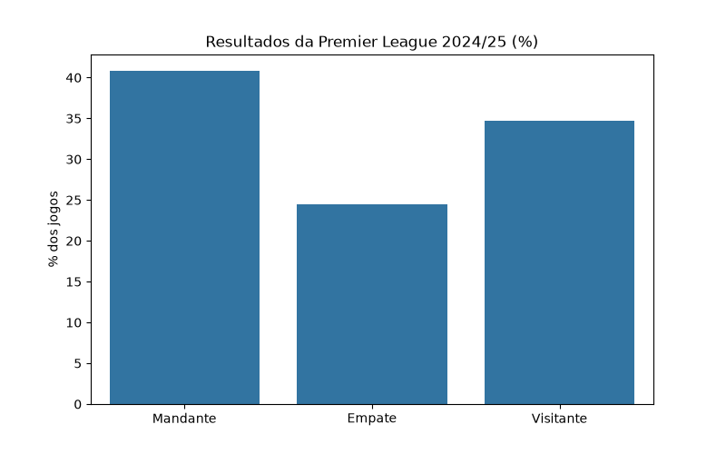

# Análise da Premier League 2024/25

Projeto de análise de dados em Python sobre os resultados da temporada 2024/25 da Premier League, a primeira divisão do futebol inglês.

## Objetivo

Descobrir se jogar em casa dá vantagem: com que frequência o time mandante vence, empata ou perde?

## Dados

- **Fonte:** [football-data.co.uk](https://www.football-data.co.uk/englandm.php)
- **Período:** temporada 2024/25
- **Tamanho:** 380 jogos (20 times, cada um enfrentando os outros 19 em casa e fora)

## O que o código faz

1. Carrega o CSV da temporada diretamente do site com o pandas.
2. Seleciona as colunas úteis (data, times, gols e resultado) e renomeia para nomes mais claros.
3. Converte a coluna de data para o formato de data do pandas.
4. Calcula o percentual de vitórias do mandante, empates e vitórias do visitante.
5. Gera um gráfico de barras e salva em `imagens/resultados.png`.

## Resultado



A vitória do mandante foi o resultado mais frequente da temporada, com **40%** dos jogos, contra **25%** de empates e **35%** de vitórias do visitante. Isso indica que jogar em casa traz vantagem, mas a análise cobre só uma temporada e não permite concluir que o padrão se repete.

## Como rodar

```bash
pip install -r requirements.txt
python analise.py
```

Antes de rodar, crie uma pasta chamada `imagens` na raiz do projeto.

## Tecnologias

Python, pandas, matplotlib e seaborn.

## Próximos passos

- Juntar várias temporadas para ver se a vantagem do mandante se mantém
- Comparar a temporada 2020/21, disputada em boa parte sem torcida, com as demais
- Incluir mais estatísticas, como gols por jogo e classificação final